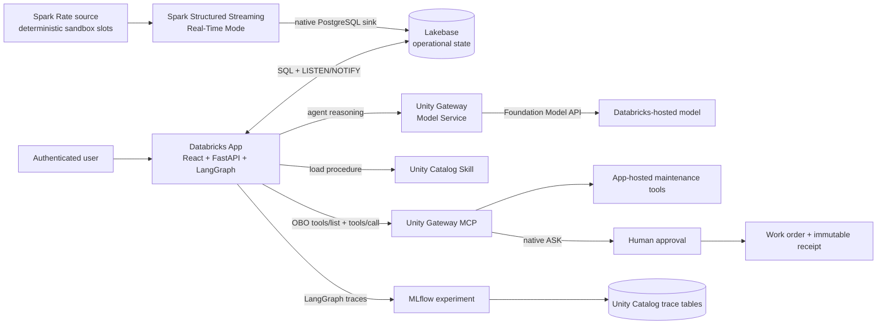

# Asset Reliability Command Centre

Asset Reliability Command Centre is a customer-facing Databricks reference demo for detecting
industrial pump risk, investigating it with an autonomous agent, and governing the resulting
maintenance action with a real human approval.

The demo is designed to show how Databricks data, operational serving, application, AI and
governance capabilities work as one system. It is not a production maintenance product or a
claim of measured customer value. All telemetry, incidents and work orders are synthetic.

## What the demo shows

A signed-in user receives a private, live estate of eight pumps. Two normal operating transients
occur once when the sandbox is first created or explicitly reset; the agent reviews them and
correctly takes no action. The user can then trigger a P-204 bearing-degradation excursion and
watch the complete governed response:

1. Spark Real-Time Mode writes live telemetry into the user's isolated Lakebase sandbox.
2. A threshold breach autonomously starts a LangGraph agent hosted in Databricks Apps.
3. The agent reasons through a Unity Gateway Model Service serving a Foundation Model API.
4. It loads a governed Unity Catalog Skill and discovers the available MCP tools at runtime.
5. Unity Gateway applies policy to every tool call and returns native `ASK` before the
   consequential work-order submission.
6. The graph pauses for a real human decision, replays the approved call exactly once, and records
   the resulting work order and immutable governance receipt.
7. MLflow captures the real LangGraph trace, token usage and evaluation evidence.

The App renders only runtime-emitted model, Skill, MCP, policy and tool activity. It does not
fabricate an agent narrative or hard-code a successful tool sequence into the interface.

## Why this demo exists

Process manufacturers and power generators depend on pumps for cooling, lubrication and fluid
movement. A developing bearing fault can become lost production, a forced outage or equipment
damage if it is detected too late. Industry research gives the problem material scale:

- Poor maintenance strategies can reduce productive capacity by **5–20%**, while unplanned
  downtime costs industrial manufacturers an estimated **$50 billion per year**
  ([Deloitte Insights, 2017](https://www2.deloitte.com/us/en/insights/focus/industry-4-0/using-predictive-technologies-for-asset-maintenance.html)).
- Pumps represent **27% of the electricity used by industrial systems in manufacturing**
  ([U.S. Department of Energy, 2006](https://www.energy.gov/sites/prod/files/2014/05/f16/pump.pdf)).

The demo's illustrative site projection assumes 24 critical pumps, eight forced incidents a
year, 7.5 downtime hours per incident and £80,000 of operational impact per hour. A 25% reduction
would recover 15 hours of productive capacity and reduce annual exposure by **£1.2M**. These are
transparent example inputs, not observed prototype results. A customer should replace them with
its asset register, failure history, downtime duration and impact per hour.

The intended outcome is protected availability with less emergency work. A production programme
should measure avoided forced-outage hours, the shift from emergency to planned maintenance,
time from breach to risk decision, energy intensity and agent cost per completed workflow.

## Databricks feature focus

| Databricks capability | Purpose in the demo |
| --- | --- |
| Spark Structured Streaming in Real-Time Mode | Generates and processes continuous telemetry with low latency using one shared stream rather than one query per user. |
| Lakebase | Serves current operational state, personal sandbox controls, incidents, approvals, work orders and audit receipts. |
| Databricks Apps | Hosts the React/FastAPI command centre and LangGraph runtime close to governed data and AI services. |
| Databricks identity and on-behalf-of-user access | Resolves the signed-in user, isolates their sandbox and carries their identity to governed operations. |
| Unity Catalog | Governs the project namespace, streaming checkpoint Volume, agent Skill and durable trace storage. |
| Unity Gateway Model Service | Provides the governed route from LangGraph to the selected Foundation Model API. |
| Unity Gateway MCP and service policy | Discovers tools, enforces source identity and creates the native `ASK` approval boundary before a write. |
| MLflow 3 | Records LangGraph traces, model usage and GenAI evaluation results, with links from the App to the managed experiment. |
| Databricks bundle resources | Defines the App, jobs, compute policy, Lakebase project, experiment and governance resources as parameterised deployment assets. |

The point is not simply to place an LLM beside a dashboard. It is to demonstrate a governed
operating loop in which streaming context, transactional state, agent reasoning, policy,
human authority and long-term evidence remain connected.

## Architecture



One Spark Rate source produces deterministic telemetry slots. Lakebase leases a slot to each
authenticated user's active sandbox and isolates telemetry, commands, incidents, agent state,
approvals and work orders. The App admits concurrent agent runs; one user's investigation does
not create a cross-sandbox queue.

The Rate source is a scalable demo adapter, not the proposed plant ingress. The in-App
Architecture tab deliberately shows Kafka as the production reference: a real deployment can
replace synthetic generation with plant telemetry while retaining the downstream Real-Time Mode,
Lakebase, App and governance pattern. Optional Kafka, Lakeflow Declarative Pipelines and Genie
assets remain in the repository for that reference, but they are inactive and are not required by
the default personal-sandbox installation.

See [Technical architecture](docs/ARCHITECTURE.md) for component responsibilities, concurrency,
identity, recovery and governance details.

## Repository map

| Path | Contents |
| --- | --- |
| `frontend/` | React command centre, incident review, architecture and LangGraph views |
| `backend/` | FastAPI routes, Lakebase repository, LangGraph runtime, MCP tools and MLflow tracing |
| `src/streaming/` | Spark Rate-to-Lakebase Real-Time Mode workload |
| `src/migrations/` and `sql/` | Idempotent operational schema and governed data assets |
| `skills/` | Governed response procedure installed as a Unity Catalog Skill |
| `resources/` | Optional production-reference bundle fragment |
| `scripts/deploy.py` | Checked preflight, install and update entry point |
| `databricks.yml` | Parameterised Databricks resources |
| `tests/` | Runtime, concurrency, governance and deployment-contract tests |

## Install in a customer workspace

Installation is deliberately explicit. Git operations never deploy or change a Databricks
workspace, and the installer never reads credentials from a values file. Authentication remains
in the named Databricks CLI profile selected on every command.

### 1. Confirm prerequisites

The deploying operator needs:

- Python 3.11 or later, `uv`, Node.js and npm;
- Databricks CLI 1.17 or later, authenticated with OAuth under a named profile;
- a workspace and region supporting Databricks Apps, Lakebase, Spark Real-Time Mode, Unity
  Gateway, Foundation Model APIs and MLflow 3;
- an existing Unity Catalog catalog, SQL warehouse and workspace App-access group;
- permission to create or update the project schema, Volume, jobs, compute policy, App, Lakebase
  resources, experiment, Model Service, governed Skill, MCP service and policy function; and
- capacity for the fixed-size classic Spark Real-Time Mode workload.

Cloud-specific node types and all workspace resource names are supplied at install time; they are
not copied from the original demo workspace.

### 2. Clone and prepare the source

```bash
git clone https://github.com/dan-keeling-databricks/asset-reliability-command-center.git
cd asset-reliability-command-center
uv sync --locked
npm --prefix frontend ci
```

Authenticate to the exact target and verify the profile before continuing:

```bash
databricks auth login \
  --host "https://<customer-workspace-host>" \
  --profile "<customer-cli-profile>"
databricks auth describe --profile "<customer-cli-profile>" -o json
```

Never rely on the default profile. Confirm that the returned host and user are the intended
deployment target.

### 3. Prepare customer values

Copy the [customer configuration worksheet](docs/examples/customer-values.example.yml) to an
ignored or external location and replace every angle-bracket placeholder. It records non-secret
names and identifiers only; the deployment script does not load the file.

The customer must choose:

- target host, named CLI profile and bundle target;
- catalog, project schema, checkpoint Volume, SQL warehouse and approved classic node type;
- App name and existing workspace access group;
- Lakebase project, branch, database, endpoint and operational schema names;
- Foundation Model API model and Unity Gateway Model Service name;
- MLflow experiment path, Unity Catalog trace location and trace-reader principal;
- governed Skill, MCP connection/service and policy-function names; and
- sandbox capacity, telemetry rate, source partitions and global agent concurrency.

The App's service principal is resolved from the App created in the target workspace. Do not
copy a service-principal ID, token or secret from another environment.

### 4. Run read-only preflight

Use the complete, copyable command in the
[customer deployment command template](docs/CUSTOMER_DEPLOYMENT.md#command-template), with the
values from the worksheet and the operation set to `preflight`.

Preflight does not mutate the workspace. It checks the explicit profile and expected host, runs
the locked local quality gate, scans the staged App snapshot for excluded files and original
environment hard-codes, and strictly validates the parameterised bundle. Stop if the printed
host, user, source commit, App name or change scope is unexpected.

### 5. Install and verify

After reviewing successful preflight output, rerun the identical command with `install` in place
of `preflight`. The installer reconciles the resources in dependency order: foundational bundle
assets, Lakebase and its idempotent schema, Unity Catalog grants, Rate-to-Lakebase Real-Time Mode,
Model Service and MLflow, governed Skill/MCP/policy, and finally the App snapshot.

Installation success proves resource reconciliation, not the business journey. Before sharing
the App, complete the [live acceptance checklist](docs/CUSTOMER_DEPLOYMENT.md#3-complete-live-acceptance):

- confirm App build identity, platform health and fresh telemetry;
- sign in as two users and prove sandbox isolation;
- replay the one-shot P-202 and P-207 normal transients;
- trigger P-204 and inspect genuine Skill, MCP, model and tool activity;
- prove native `ASK`, one approved replay, one work order and one immutable receipt; and
- open the persisted LangGraph trace and evaluation evidence in MLflow.

### Updates, rollback and decommissioning

Use `update` with the same explicit customer values for reviewed changes. App-only updates are
supported only when every runtime change is inside the documented App snapshot boundary; data,
governance, experiment or bundle changes require a complete update. Rollback is a forward deploy
of a known-good commit, never a schema reversal or destructive Git operation. Decommissioning is
manual so customer-owned catalogs, warehouses, groups and Lakebase resources are not removed by
assumption.

Read [Customer installation and lifecycle](docs/CUSTOMER_DEPLOYMENT.md) in full before operating
a shared installation.

## Local development

The local fixture exercises the command-centre interface without Spark, Lakebase, model serving
or Unity Gateway:

```bash
uv sync --locked
npm --prefix frontend ci
./scripts/dev.sh
```

Open `http://127.0.0.1:5173`. `APP_ADAPTER=local` provides deterministic development data. It is
not evidence that the governed Databricks journey works; that requires live acceptance in the
target workspace.

## Validation

```bash
uv run ruff check backend tests src scripts
uv run pytest
npm --prefix frontend run typecheck
npm --prefix frontend run build
uv run python scripts/deploy.py --help
```

The repository uses manual, reviewed deployment. A merge or Git push never deploys the App or any
other Databricks resource.

## Scope and production considerations

This repository is a reference implementation and demo scaffold. Before adapting it for a
production maintenance process, review the documented
[technical debt and accepted trade-offs](docs/TECHNICAL_DEBT.md), including safety budgets for
agent loops, operational rejection metrics, schema portability, integration testing,
accessibility and component decomposition. Replace synthetic telemetry, example thresholds,
maintenance logic, model choice, policies and value assumptions with customer-owned contracts and
controls.

No customer data, credentials or generated secrets belong in this repository.

## Historical Kafka-build execution evidence

The earlier Kafka-based build is retained as dated, text-readable validator evidence; it is not
presented as proof of the current Rate-source implementation. Its accepted run recorded:

```text
telemetry_bronze       3,884,768
telemetry_silver       3,884,704
P-204 | 7.6
Failure risk 96% (high)
WO-35374 scheduled
{"end_to_end_latency_ms": 90}
```

The complete identifiers, SQL, tool sequence and governance receipt are in
[Historical Kafka-build Databricks execution evidence](DATABRICKS_END_TO_END_EXECUTION_EVIDENCE.md).

## Documentation and evidence

- [Business demo flow](DEMO.md)
- [Technical architecture](docs/ARCHITECTURE.md)
- [Customer installation and lifecycle](docs/CUSTOMER_DEPLOYMENT.md)
- [Customer configuration worksheet](docs/examples/customer-values.example.yml)
- [Manual deployment and live acceptance](docs/DEPLOYMENT.md)
- [Technical debt and accepted trade-offs](docs/TECHNICAL_DEBT.md)
- [Current implementation status](TASKS.md)
- [Contribution and branching model](CONTRIBUTING.md)
- [Historical Kafka-build execution evidence](DATABRICKS_END_TO_END_EXECUTION_EVIDENCE.md)
- [Detailed evidence archive](evidence/README.md)

The historical evidence proves the earlier Kafka-based integrated build only. It is retained for
auditability and does not claim execution of the current personal-sandbox Rate-source build.
