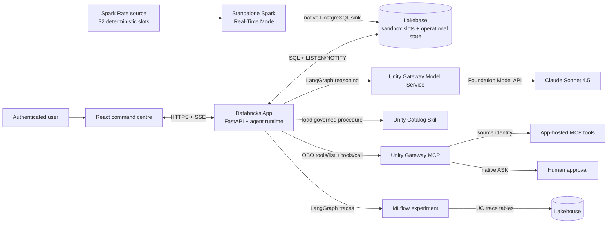

# Technical architecture

## Scope and design principles

The Asset Reliability Command Centre is an end-to-end process-manufacturing prototype. It
combines continuous synthetic pump telemetry, isolated low-latency operational serving,
autonomous incident response, and a real human-approval boundary.

The primary experience is the live command centre. Alerts launch agents automatically; the
presenter never types the initiating prompt. The UI renders model, Skill, MCP, policy, and tool
activity only after the runtime emits it. Unity Gateway—not application code—is the approval
authority for the maintenance write.

## End-to-end topology

## Data journey

### 1. Synthetic source and personal sandbox control plane

One Spark Rate source continuously produces two observations per second for each of eight pumps
in every configured generator slot. The initial capacity is 32 slots, or 512 input rows per
second. Slot, pump, sequence and event identifiers are derived deterministically from the Rate
value; RTM does not run one query per user.

On first access, the App derives the user from trusted Databricks identity headers and leases a
slot under a Lakebase row lock. Lakebase maps generated rows for that slot to the user's active
sandbox and scenario. Stable baselines are deterministic. First sandbox creation and every
explicit reset atomically seed one P-202 startup-recirculation event and one P-207 valve-transition
event in `normal_transient_events`. The first matching telemetry sample activates each event; ten
seconds later it becomes completed and cannot recur in that scenario. Durable, sandbox-scoped
controls apply the presenter-triggered P-204 degradation. An
unallocated or expired slot produces no stored telemetry.

### 2. Operational path: Real-Time Mode to Lakebase

The standalone Spark Structured Streaming job runs in Real-Time Mode on fixed-size classic
compute. It uses the native PostgreSQL sink with workspace-managed authentication to write
generated rows to Lakebase. A Lakebase trigger resolves the active sandbox and scenario, applies
the scoped excursion, and maintains `pump_live_state`. Persistent streaming state uses a Unity
Catalog Volume checkpoint; DBFS is not used.

The App reads bounded, sandbox-filtered current state and per-pump top-N queries, coalesces
database notification bursts, and pushes canonical snapshots over SSE. An independent evaluator
scans active sandboxes and creates an incident exactly once when a sandbox's alert rule enters its
trigger state.

Standalone RTM remains separate because the native Lakebase streaming sink is not supported
inside the public Lakeflow Declarative Pipelines Real-Time Mode surface.

### 3. Production reference and durable history

The App's Architecture-tab visual deliberately keeps Kafka as the production ingress reference.
A real deployment can replace the synthetic Rate adapter with plant telemetry from Kafka while
retaining the same RTM, Lakebase, App and governance components. The repository retains the former
Kafka producer, SQL Lakeflow pipeline and Genie assets for that reference and for forward-only
rollback, but the personal-sandbox deployment does not run or health-check those continuous jobs.

Lakehouse Sink is the durable route for long-term operational telemetry plus LLM and MCP traces.
The deployed personal-sandbox path keeps its low-latency working state in Lakebase; dated evidence
from the earlier Kafka/Lakeflow/Genie build remains an archive and is not presented as current
execution evidence.

The standalone RTM job executes as the customer who deploys the dedicated demo. A bundle-managed
least-privilege compute policy limits it to the approved fixed-size classic shape, runtime and
on-demand availability. Runtime job source is pinned to the public Git commit selected by the
bundle deployment.

The App applies the idempotent Lakebase migration during startup as its own service principal,
preserving App ownership of the operational schema. DAB waits for the App to start before creating
the continuous RTM job, so telemetry cannot race an older database contract. This avoids a second
classic-compute cold start and any account-level impersonation grant during customer installation.
Governance reconciliation runs on serverless jobs compute with ambient workload authentication;
it still blocks deployment until the Skill, MCP service, policy and non-executing probe validate.

## Databricks App and autonomous AI experience

### Autonomous reliability agent

The alert evaluator creates a machine-authored prompt containing the pump, observed threshold
condition, timestamp, incident identifier, and maintenance objective. A background task per
incident permits concurrent evaluations, including independent incidents in the same personal
sandbox. The App admits up to 20 agent runs at once; it does not impose a cross-sandbox queue or
serialise the investigation phase within one sandbox.

The agent is an explicit LangGraph hosted in the Databricks App. Its nodes load incident context,
load the governed UC Skill, discover MCP tools, invoke the model, execute the selected governed
tool, loop over returned evidence, resolve no action, or pause at a genuine Gateway `ASK`.
Approval enters the graph through a separate resume node which derives state from Lakebase and
replays the exact claimed request once. Lakebase—not an in-memory LangGraph checkpointer—remains
canonical for durable approval state.

Model inference uses the OpenAI-compatible Responses API exposed by a Unity Gateway Model Service.
That governed service currently routes 100% of traffic to the
`system.ai.databricks-claude-sonnet-4-5` Foundation Model API. The LangGraph loads the governed UC
Skill, calls `tools/list` on the configured MCP service, and lets the model choose tools without a
UI-imposed stage or call cap. The current discovered tools are:

- `get_asset_telemetry`
- `assess_failure_risk`
- `prepare_work_order`
- `submit_work_order`

Every model or tool activity is persisted and rendered separately. OBO identity and the opaque
MCP run context remain outside traceable graph state. MLflow LangChain autologging plus one outer
application span records graph execution to a bundle-managed experiment with Unity Catalog trace
storage. Stable root attributes identify the real pump, incident and terminal outcome for GenAI
evaluation. The App's Agent graph tab explicitly separates its static design view from links to
actual MLflow evidence.

## Governance and identity boundaries

The App-to-Gateway hop uses the current user's OBO token. Gateway evaluates that user's tool
access and policy. The Gateway-to-source hop is different: the configured HTTP connection uses
the App service principal, and `/mcp` rejects human callers that try to bypass Gateway.

Because the Gateway-to-source hop does not carry the human identity, the runtime creates an opaque
context for every agent run. It removes that internal field from the model-visible tool schema and
injects it only immediately before the Gateway request. The MCP source resolves the context back
to the run, incident, scenario and sandbox and fails closed for unknown, terminal or mismatched
contexts.

The custom `submit_work_order` policy returns native `ASK`. The agent persists the exact pending
request and stops before source execution. Approval replay is single-flight: an atomic lease
allows only one caller to resume the request. A successful replay creates an immutable governance
receipt containing the elicitation identifier, request hash, approving subject, decision, and
timestamps. Denial, repeated `ASK`, and transport errors cannot be represented as success.
Approved submission is serialised only against other lifecycle-changing operations in the same
sandbox. Model reasoning and read-only investigation remain concurrent, and activity in one
user's sandbox cannot hold another user's governed submission.

The deployment helper reconciles the Skill, MCP source connection, selected tools, service
policy, and App-source permission. Its probe first requires exact tool discovery and a benign
source read, then must receive `ASK` with `execution=not executed` before governance deployment is
considered valid.

OBO access tokens live only in process memory and are never logged or persisted. Identity subjects
are retained for audit. A sandbox restart cancels and awaits only its local tasks, while active
scenario/run predicates and UUID/version approval claims fence delayed work from other replicas
before any state transition or governed completion.

## Lakebase operational model

| Table | Purpose |
| --- | --- |
| `pumps`, `alert_rules` | Fleet metadata and threshold/hysteresis rules |
| `sandboxes`, `sandbox_slots`, `sandbox_controls` | User ownership, generator leases and excursions |
| `normal_transient_events` | Explicit one-shot P-202/P-207 events for first creation and reset |
| `scenario_runs`, `scenario_commands` | Sandbox-scoped demo lifecycle |
| `telemetry_events`, `pump_live_state` | Operational event log and bounded latest state |
| `incidents`, `agent_runs` | Alert and autonomous-execution lifecycle |
| `activity_events`, `conversation_messages` | Ordered runtime activity and operator follow-ups |
| `work_orders`, `governance_receipts` | Governed outcome and immutable approval evidence |
| `run_identities`, `app_users` | OBO subject and App-user audit |
| `component_heartbeats` | Rate RTM and evaluator freshness signals |

Run and incident rows act as sequence-allocation locks for concurrent timeline writers. Database
uniqueness constraints remain the final idempotency guard for scenarios, commands, events,
incidents, and work orders.

## Health, recovery, and retention

The top-right App status is derived from Lakebase reachability, latest sandbox telemetry, Rate
RTM's durable effect, and evaluator heartbeat. A stale signal changes the state to degraded and
identifies the affected component.

Operational telemetry is retained for 24 hours. Batched, index-backed cleanup is best effort and
cannot block ingestion. Idle sandbox leases expire after two hours by default; immutable
governance receipts are never deleted.

The generated root `.build-info.json` records the clean Git commit included in a deployment; the
App exposes it through `/api/build-info`. Deployment stages this file with only the App's runtime
Python, compiled frontend, Lakebase migration, and dependency manifests under `.artifacts/app`.
The App snapshot is rooted there so managed Genie workspace nodes and non-runtime bundle assets
cannot enter the snapshot. Deployment is repository-first and driven by `databricks bundle deploy`.

## Repository map

| Path | Contents |
| --- | --- |
| `frontend/` | React personal command centre |
| `backend/` | FastAPI, Lakebase repository, autonomous runtime, Genie adapter, MCP tools |
| `src/streaming/` | Standalone Spark RTM Rate-to-Lakebase notebook source |
| `src/producer/`, `src/pipelines/`, `genie/` | Retained production-reference and rollback assets |
| `skills/` | Governed UC Skill source |
| `sql/` | Lakebase schema, view grants, and Gateway policy function |
| `scripts/` | Checked deployment and idempotent data/governance helpers |
| `tests/` | API, runtime, governance, data-plane, concurrency, and deployment contracts |
| `docs/` | Architecture, deployment, evidence, and technical-debt records |
| `.artifacts/app/` | Ignored, reproducibly generated runtime-only App snapshot source |
